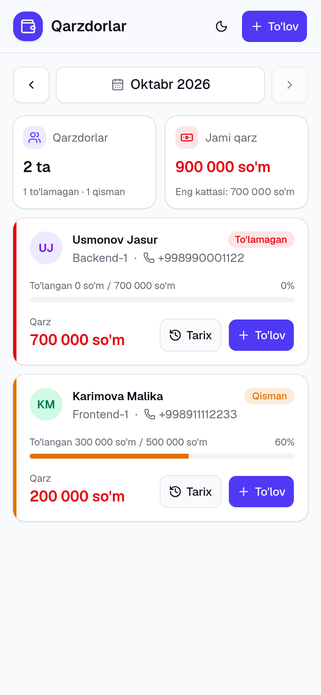
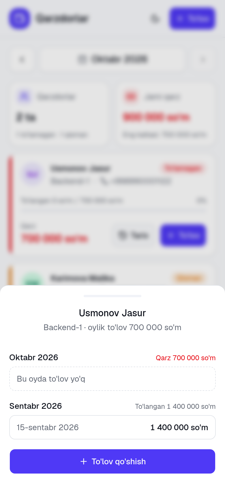
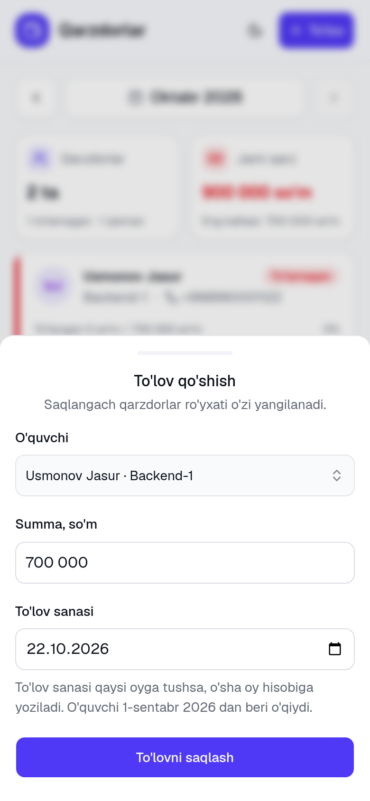

# O'quv markazi: to'lovlar

O'quv markazi uchun to'lovlarni hisobga oluvchi mini tizim. O'quvchilar va ularning to'lovlari saqlanadi, tanlangan oy bo'yicha kim qancha qarzi borligi ko'rsatiladi. Har bir qarzdorning to'lovlar tarixini oylar bo'yicha ko'rish va shu yerdan to'lov qo'shish mumkin. Veb-sahifa telefonda ishlatishga moslangan, yorug' va qorong'i rejimni qo'llaydi.

<p>
  
  &nbsp;
  
  &nbsp;
  
</p>

| Qism | Texnologiyalar |
| --- | --- |
| Backend | Node.js, TypeScript (strict), NestJS 11, Prisma 6, SQLite, Swagger |
| Frontend | React 19, TypeScript (strict), Vite, Tailwind CSS 4, shadcn/ui, TanStack Query, react-hook-form + zod |
| Testlar | Jest (unit + e2e, alohida test bazasida), Vitest + Testing Library |

## Ishga tushirish

Kerak: **Node.js 20.19+** (yoki 22+) va npm. Boshqa hech narsa o'rnatish shart emas: baza SQLite fayli, u avtomatik yaratiladi.

```bash
git clone https://github.com/jamshid-coder-engineer/edu-payments.git
cd edu-payments
npm run setup   # paketlar, backend/.env, baza migratsiyasi va namunaviy ma'lumotlar
npm run dev     # backend va frontend birga
```

Keyin oching:

- Ilova: http://localhost:5173
- API: http://localhost:3000
- Swagger (API hujjati): http://localhost:3000/docs

`npm run setup` mavjud `backend/.env` faylga tegmaydi. Namunaviy ma'lumotlar joriy oyga nisbatan yaratiladi, shuning uchun ro'yxatda har doim turli holatlar bo'ladi: to'liq to'lagan, qisman to'lagan, umuman to'lamagan, oy o'rtasida qo'shilgan.

**Telefondan ochish** (kompyuter bilan bitta Wi-Fi'da):

```bash
npm run dev:host
```

Terminalda chiqqan `Network: http://192.168.x.x:5173` manzilini telefonda oching. API so'rovlari Vite orqali backendga yo'naltiriladi, shuning uchun alohida sozlash kerak emas.

### Buyruqlar

| Buyruq | Nima qiladi |
| --- | --- |
| `npm run setup` | Hamma narsani o'rnatadi va bazani tayyorlaydi |
| `npm run dev` | Backend (3000) va frontend (5173) ni birga ishga tushiradi |
| `npm run dev:host` | Xuddi shu, frontend lokal tarmoqda ham ochiladi (telefondan kirish uchun) |
| `npm test` | Backend unit + e2e va frontend testlari |
| `npm run build` | Ikkala qismni production uchun yig'adi |
| `npm run lint` | Lint tekshiruvi |
| `npm run db:seed` | Namunaviy ma'lumotlarni qaytadan yozadi |

## API

| Metod | Yo'l | Tavsif |
| --- | --- | --- |
| `POST` | `/students` | O'quvchi qo'shish |
| `GET` | `/students` | O'quvchilar ro'yxati |
| `GET` | `/students/:id` | Bitta o'quvchi |
| `PATCH` | `/students/:id` | Tahrirlash |
| `DELETE` | `/students/:id` | O'chirish (to'lovlari ham o'chadi) |
| `POST` | `/payments` | To'lov qo'shish |
| `GET` | `/students/:id/payments` | O'quvchi to'lovlari tarixi, eng yangisi birinchi |
| `GET` | `/debtors?month=YYYY-MM` | Tanlangan oy qarzdorlari |

Misol:

```bash
curl -X POST http://localhost:3000/payments \
  -H 'Content-Type: application/json' \
  -d '{"studentId": 1, "amount": 300000, "paidAt": "2026-10-05"}'

curl 'http://localhost:3000/debtors?month=2026-10'
```

```json
[
  {
    "studentId": 3,
    "name": "Rahimov Sardor",
    "phone": "+998935556677",
    "group": "Frontend-1",
    "monthlyFee": 500000,
    "paid": 0,
    "debt": 500000
  }
]
```

### Qarz qanday hisoblanadi

`debt = max(0, monthlyFee - shu oydagi to'lovlar yig'indisi)`. Ro'yxatga faqat `debt > 0` bo'lganlar kiradi, katta qarz birinchi.

- To'lov sanasi (`paidAt`) qaysi oyga tushsa, o'sha oy hisobiga yoziladi. Bir oydagi bir nechta to'lov qo'shiladi.
- Ortiqcha to'lov keyingi oyga o'tkazilmaydi.
- O'quvchi qo'shilgan oydan (`joinedAt`) oldingi oylar uchun qarzdor emas. Oy o'rtasida qo'shilsa, shu oy uchun to'liq summa hisoblanadi.
- Qarz o'quvchining joriy `monthlyFee` si bo'yicha hisoblanadi.

### Tekshiruvlar

- Telefon: `+998XXXXXXXXX`, bo'shliq va chiziqchalar avtomatik olib tashlanadi.
- Summa: musbat butun son (so'm), 100 mln gacha.
- Sana: `YYYY-MM-DD`, mavjud kalendar sanasi. Kelajakdagi va o'quvchi qo'shilishidan oldingi to'lov qabul qilinmaydi.
- Noto'g'ri ma'lumot: `400` va tushunarli xabar. Topilmagan o'quvchi: `404`. Ortiqcha maydonlar rad etiladi.
- Xavfsizlik: `helmet` sarlavhalari, CORS faqat frontend manziliga, bitta IP'dan daqiqasiga 120 so'rov.

## Loyiha tuzilmasi

```
backend/
  prisma/            schema, migratsiyalar, seed
  src/
    students/        CRUD
    payments/        to'lov qo'shish va tarix
    debtors/         qarzdorlar; hisob toza funksiyada (debt-calculator.ts)
    common/          sana, chegaralar, validatorlar, sozlamalar
  test/              e2e testlar (alohida test.db)
frontend/
  src/
    features/
      debtors/       qarzdorlar sahifasi, oy tanlash, kartochkalar
      payments/      to'lov paneli, forma va uning qoidalari, to'lovlar tarixi
      students/      o'quvchi tanlash
    components/      umumiy komponentlar (ui/ — shadcn/ui)
    lib/             API klient, sana va summa yordamchilari
    test/            test sozlamalari, soxta backend (fetch mock)
```

### Qarorlar

- **Summalar butun son (so'm).** Kasr sonlar bilan yaxlitlash xatolari bo'lmaydi.
- **Sanalar `YYYY-MM-DD` matni.** Vaqt zonasi tufayli to'lov boshqa kunga yoki oyga o'tib ketmaydi. "Bugun" `APP_TIMEZONE` (standart `Asia/Tashkent`) bo'yicha aniqlanadi.
- **Qarz hisobi bazadan ajratilgan toza funksiya.** Shu sababli barcha holatlar (oy chegaralari, dekabr → yanvar, bir nechta to'lov, ortiqcha to'lov) unit testlar bilan tekshirilgan.
- **Frontend testlari foydalanuvchi ko'zi bilan.** Komponentlar soxta backend bilan tekshiriladi: ro'yxat, xato va qayta urinish, forma qoidalari, backend xabari, kartochkadan to'lov qo'shib ro'yxat yangilanishi. Kutilmagan xatoda oq ekran o'rniga xabar chiqadi (Error Boundary).
- **SQLite.** O'rnatish shart emas, `git clone` dan keyin darhol ishlaydi. PostgreSQL'ga o'tish uchun Prisma'da `provider` ni almashtirib, migratsiyani qayta yaratish yetarli, kod o'zgarmaydi.

### Muhit o'zgaruvchilari (`backend/.env`)

| O'zgaruvchi | Standart | Tavsif |
| --- | --- | --- |
| `DATABASE_URL` | `file:./dev.db` | SQLite fayli |
| `PORT` | `3000` | Backend porti |
| `APP_TIMEZONE` | `Asia/Tashkent` | "Bugun" va "joriy oy" uchun |
| `CORS_ORIGIN` | `http://localhost:5173` | Frontend manzili, bir nechta bo'lsa vergul bilan |
| `RATE_LIMIT_PER_MINUTE` | `120` | Bitta IP uchun so'rovlar chegarasi |

## Yana bir hafta bo'lsa nimani yaxshilardim

1. **To'lov qaysi oy uchun ekanini alohida saqlash.** Hozir to'lov sanasi qaysi oyga tushsa, o'sha oy hisobiga yoziladi: sentabr qarzini oktabrda to'lasa, u oktabrga yoziladi. `billingMonth` maydoni va o'quvchi balansi (avans, eski qarz) bilan ortiqcha to'lov keyingi oyga o'tadi.
2. **Tariflar tarixi.** Hozir `monthlyFee` o'zgarsa, o'tgan oylar qarzi ham yangi summa bilan hisoblanadi. Tarif o'zgarishlarini sana bilan saqlash kerak.
3. **Kirish va rollar.** Admin va kassir uchun login, kim qaysi to'lovni kiritganini yozib borish. Xato to'lovni o'chirish o'rniga bekor qilish (storno).
4. **Interfeysni kengaytirish.** O'quvchilarni qo'shish va tahrirlash sahifasi, qidiruv. API'da sahifalab berish (pagination).
5. **Production'ga tayyorlash.** PostgreSQL va Docker Compose, GitHub Actions'da testlar, Playwright bilan brauzer testlari.
